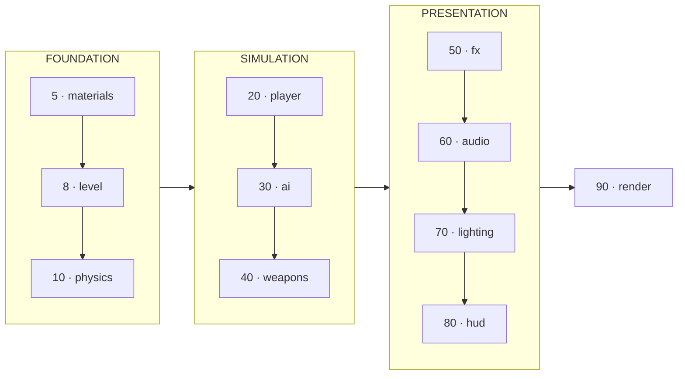
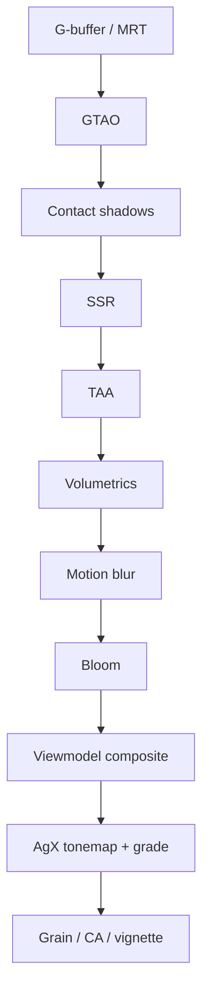
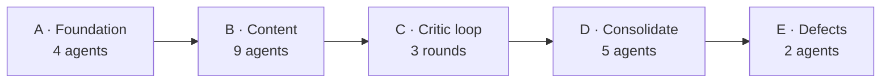

<div align="center">

# OPERATION BLACKOUT

### A contemporary-military FPS that runs in a browser tab

**Every texture, every mesh, and every sound is generated procedurally in code.**<br/>
No images. No models. No audio files. No CDN. It boots with the network unplugged.

[](https://threejs.org)
[](https://rapier.rs)
[](https://caniuse.com/webgl2)
[](#zero-assets)
[](#performance)
[](LICENSE)
[](https://claude.com/claude-code)

**Built with Claude Opus 5 in Claude Code.** One prompt wrote the build contract; 11 parallel agents, a critic loop and a consolidation pass did the rest.

### **[▶  PLAY IT IN YOUR BROWSER](https://operation-blackout-8xf.pages.dev)**

<sub>No install, no login. ~8s first load while it synthesises every texture. Desktop only.</sub>


**[▶ Watch 15s of gameplay](docs/demo.mp4)**

</div>

---

## ▸ Play it

**Live: [operation-blackout-8xf.pages.dev](https://operation-blackout-8xf.pages.dev)** — nothing to install.

Or run it locally:

```bash
git clone https://github.com/rushindrasinha/operation-blackout
cd operation-blackout
npm install
npm run dev
```

Open **http://localhost:5173**, click to lock the pointer, and you're in.

> **Desktop only.** Needs a keyboard, a mouse, pointer lock and a real GPU.
> It will load on a phone and then be unplayable.

<table>
<tr><td width="50%">

**Movement**

| Key | Action |
|:--|:--|
| `W` `A` `S` `D` | Move |
| `Shift` | Sprint |
| `Ctrl` | Crouch |
| `Space` | Jump |

</td><td width="50%">

**Combat**

| Key | Action |
|:--|:--|
| `Left mouse` | Fire |
| `Right mouse` | Aim down sights |
| `R` | Reload |
| `1` `2` | M4A1 / MP5 |

</td></tr>
</table>

---

## ▸ At a glance

<table>
<tr>
<td align="center"><b>44,000</b><br/><sub>lines of JS</sub></td>
<td align="center"><b>0 bytes</b><br/><sub>external assets</sub></td>
<td align="center"><b>11</b><br/><sub>systems</sub></td>
<td align="center"><b>2</b><br/><sub>dependencies</sub></td>
</tr>
<tr>
<td align="center"><b>59–72</b><br/><sub>fps @ 1080p</sub></td>
<td align="center"><b>4.4M</b><br/><sub>triangles</sub></td>
<td align="center"><b>~350</b><br/><sub>draw calls</sub></td>
<td align="center"><b>1.29 MB</b><br/><sub>gzipped</sub></td>
</tr>
</table>

---

## ▸ Screenshots

Captured at 1920×1080 by the headless harness. Unedited, in-game HUD visible.

| | |
|:--:|:--:|
|  |  |
| **Warehouse** — volumetric shafts, sodium practicals | **Overwatch** — stacked containers, layered depth |
|  |  |
| **Lane** — into-sun framing, aerial perspective | **Close quarters** — contact shadows, ground detail |

---

<a name="zero-assets"></a>

## ▸ The constraint that shaped everything

There are no asset files. Not "few" — **none**.

```
❌  .jpg  .png  .hdr        →  ✅  multi-octave FBM noise, Sobel-filtered normals
❌  .glb  .fbx  .obj        →  ✅  procedural geometry with bevelled edges
❌  .wav  .mp3  .ogg        →  ✅  Web Audio synthesis + procedural convolution reverb
❌  CDN  ·  fetch  ·  API   →  ✅  nothing leaves the page
```

This isn't minimalism for its own sake. It means every visual has to be *earned by
synthesis code* — you cannot photogrammetry your way out of a problem. A rusted steel
panel is a function. A gunshot is a filtered noise transient, a pitch-swept body, a
mechanical layer, and a procedurally-generated impulse response.

<details>
<summary><b>How a single material is built</b></summary>

<br/>

Each of the 14 materials produces albedo (sRGB) + tangent-space normal + packed **ORM**
(R=AO, G=roughness, B=metalness), at 2048² for concrete and asphalt, 1024² for most.
Generation runs across a **6-worker pool** with transferable `ArrayBuffer`s — about 2.4s
wall clock — with two-level fallback so the game always boots.

- **4–7 octaves of FBM** with domain warping, so nothing reads as tiled
- **Normals Sobel-filtered from a separately authored height field** — never derived from
  the albedo, which is the classic tell that makes bumps look painted on
- **Roughness from a decorrelated field**, because uniform roughness is the single
  biggest amateur giveaway. Real concrete has polished patches, damp spots and chalk
- **Multi-scale cavity terms** driving crevice grime and convex edge-wear brightening
- **Gravity-following grime** — streaks propagate downward from horizontal edges
- **F2−F1 crack networks** masked by an independent field, so cracks terminate and branch
  instead of closing into obvious polygons
- **Dual-metalness rust** — metalness drops to 0 inside oxide, stays 1 on clean steel

</details>

---

## ▸ Architecture

Eleven independent systems on a fixed lifecycle. **No system imports another** — they
communicate only through a shared context object and an event bus. That constraint is
what allowed eleven of them to be built in parallel by agents that couldn't see each
other's code.



Update order is meaningful: a system may assume everything with a **lower order** is
already initialised when its `init()` runs.

```js
export class MySystem {
  static id = 'mySystem';        // becomes ctx.mySystem
  static order = 50;             // update band
  async init(onProgress) {}      // async setup, reports loading progress
  fixedUpdate(fdt) {}            // 60 Hz fixed step, physics-coupled
  update(dt, elapsed) {}         // per rendered frame
}
```

<details>
<summary><b>What each system does</b></summary>

<br/>

| System | Responsibility |
|:--|:--|
| **materials** | 14 procedural PBR materials, 6-worker generation pool |
| **level** | ~90×70 m three-lane industrial yard, instanced props, bevelled everything |
| **physics** | Rapier at fixed 60 Hz, collider→actor registry, collision groups, debris |
| **player** | Source-style acceleration, interpolated stance, spring recoil that only partially recovers |
| **ai** | Procedural soldier rigs, foot IK, independent torso aim, A\* over a raycast-built grid |
| **weapons** | Two procedural weapons, gloved hands, spring-damper look sway, hitscan ballistics |
| **fx** | Material-correct impacts, conforming projected decals, travelling tracers, soft particles |
| **audio** | Fully synthesised — no samples. HRTF spatialisation, distance low-pass, convolution tails |
| **lighting** | Custom Preetham sky mirrored on the CPU, PMREM IBL, 4-cascade CSM with texel snapping |
| **hud** | DOM overlay. No health bar — damage is vignette, desaturation and directional flashes |
| **render** | Owns the final composite |

</details>

---

## ▸ Rendering pipeline

Hand-built HDR pipeline. Stock passes are used only as plumbing; the effects are custom
shaders.



| Stage | What it does |
|:--|:--|
| **G-buffer / MRT** | colour · normal · depth · velocity into half-float targets |
| **GTAO** | XeGTAO slice formulation, half-res, depth+normal bilateral upsample |
| **Contact shadows** | short raymarch on the **direct** sun term |
| **SSR** | binary-search refinement, roughness-aware jitter, env-map fallback |
| **TAA** | Halton(2,3) jitter, velocity reprojection, YCoCg neighbourhood clipping |
| **Volumetrics** | raymarched sun shafts, half-res |
| **Bloom** | soft-knee bright pass into a dual-filter mip chain |
| **Viewmodel** | own scene at 55° FOV, composited **before** tonemap so it shares the film response |
| **Tonemap** | AgX + filmic grade: cool shadow lift, warm highlight roll |

Two decisions worth calling out, because both were counter-intuitive and both were
settled by measurement:

> **Ambient occlusion cannot ground an object lit by the sun.** A crate's underside is lit
> by the *key*, not by ambient — so no amount of AO darkens it. That needs a separate
> screen-space contact-shadow raymarch on the direct term. Three critic rounds kept
> "fixing" the AO term while the score fell 3.7 → 3.3 → 2.7.

> **Physically-correct AO is invisible.** A 1 m crate removes only ~11% of the hemisphere.
> Shipped games exaggerate contact darkening far past physical accuracy, because that's
> the cue the eye actually uses to decide something rests on the ground.

<details>
<summary><b>Measured per-pass costs — the post stack is not the bottleneck</b></summary>

<br/>

1080p, `overwatch` pose, 17.40 ms frame:

| Stage | Cost |
|:--|--:|
| **HDR forward scene render** | **~10–11 ms** |
| Viewmodel MSAA surface | 1.00 ms |
| SSR + 2 bilateral | 0.90 ms |
| Resolve (FXAA + CAS + grain) | 0.90 ms |
| GTAO + contact + 2 bilateral | 0.80 ms |
| Bloom, both lobes | 0.80 ms |
| G-buffer prepass | 0.70 ms |
| TAA | 0.50 ms |
| Motion blur | 0.50 ms |
| Volumetrics | 0.20 ms |
| **Entire optional post stack** | **3.10 ms** |

The whole post stack is **3.1 ms of a 17.4 ms frame**. The forward scene render dominates.
This is a useful correction to the reflex that post-processing is where browser renderers
get slow — an optimisation pass aimed at post could not have reached the target, and
profiling said so before any time was wasted on it.

</details>

---

## ▸ How it was built

This was built by a fleet of parallel AI agents coordinated through a written contract.
The method shaped the codebase, so it's documented rather than hidden.



Two documents did the coordination, and both are in the repo:

- **[`ARCHITECTURE.md`](ARCHITECTURE.md)** — the build contract. Strict directory
  ownership, the system lifecycle, the exact cross-system API, canonical event names.
  Agents couldn't see each other's code; this was the only thing stopping them from
  destroying each other's work.
- **[`VISUAL_BAR.md`](VISUAL_BAR.md)** — the grading rubric. Nine axes scored 0–10, an
  instant-fail list, and an honesty clause fixing the critic's job as *"what is the single
  largest remaining gap"*.

### The original prompt

The whole project came from one request, reproduced verbatim:

> I want you to build a first-person shooter at the level of the most recent Call of Duty
> games. It should be utterly perfect, visually beautiful, with every single thing done at
> AAA quality—from textures to physics to anything you could think of.
>
> Fan out sub-agents and have sub-agents tackle each one individually so that the game is
> utterly perfect. You should /loop on each item and have a separate sub-agent check it
> visually to ensure it looks triple A. That separate sub-agent should be a really harsh
> critic, and if it doesn't look triple A, it should keep going.
>
> Don't stop until each sub-agent is utterly wowed with the quality when compared with the
> actual Call of Duty game. It should literally compare them side by side blind and say
> which one looks better. Do this in ThreeJS. /loop until it's utterly perfect. Fan out
> sub-agents and ultracode.

### What wasn't followed, and why

**The termination condition could never fire.** "Loop until a critic prefers this over
Call of Duty in a blind side-by-side" has exactly one outcome — a harsh critic picks the
CoD frame every time. Modern CoD is ~1,500 people over 3–4 years with a custom engine,
photogrammetry rigs and mocap stages, streaming hundreds of gigabytes off an NVMe. This is
WebGL in a browser tab with zero authored assets. As written, the loop runs forever and
never ships. It was replaced with a bar that can actually be met and measured.

**The critic loop was stopped early, deliberately.** Three rounds scored **4.29 → 4.43 →
4.33**. Not converging — oscillating. Meanwhile triangles grew 4.7M → 6.5M and framerate
fell 82 → 52 fps. The loop had become a machine for trading performance for detail and
calling it progress.

```
        SCORE                              PERFORMANCE
  4.43 ─────●                     82 ●
  4.33 ──●     ●                     │╲
  4.29 ●                          52 │ ╲──●        ← loop stopped here
       R1  R2  R3                    R1  R2  R3
```

It was swapped for a consolidation pass that added **no content** — profile, LOD, instance
culling, restricting small shadow casters to cascade 0 — which recovered **6.5M → 4.4M
triangles and 52 → 72 fps**. Named, specific fixes kept working long after open-ended
critique had stopped.

<details>
<summary><b>Bugs worth recording — found because agents had to prove claims, not assert them</b></summary>

<br/>

**Every weapon albedo was sRGB-encoded twice.** `new THREE.Color(hex)` decodes to linear
under `ColorManagement`, and that linear value was packed into a byte handed to an
sRGB-flagged texture. A tint authored at 0.157 reached the shader at **0.021** — seven
times too dark. Someone had compensated by cranking the viewmodel key to 2.1× the world
sun, which is why the gun looked lit by a different scene than the world.

**Soldiers rendered as dithered noise.** Not transparency, not skinning — both falsified by
ablation. The real cause: normal maps baked from height fields carrying energy *above texel
Nyquist* at gains of 17–34. At p90 the x channel quantised onto ~2 codes of 255, and
mip-averaging normal **vectors** produced specular aliasing that is static in surface
space — so every TAA frame agreed on the noise and it never resolved.

**A reload bug no screenshot could catch.** `_resetParts()` restored the magazine pivot to
the origin rather than its rest pose, teleporting the magazine 56 mm through the magwell
after every reload. *"Invisible to the screenshot harness because it never reloads; plainly
visible the first time you press R."*

**One NaN could kill physics permanently.** Found by playing, not by any automated pass. A
single non-finite float panics Rust inside `world.step()`; the panic unwinds out of wasm
still holding the World's borrow, so every later Rapier call throws forever. One panic
produced **13,445 raycast failures** while the game kept rendering at full framerate —
bullets silently stopped registering and bots went blind. Two guards couldn't catch the
value they existed to catch:

```js
if (Math.hypot(x,y,z) > 16) { clamp() }   // NaN > 16 is FALSE
Math.max(1e-3, sx * 0.5)                  // Math.max(1e-3, NaN) is NaN
```

Now guarded at the wasm boundary, with a regression test (`npm run test:physics`) verified
to **fail against the pre-fix tree** — so it discriminates rather than passing vacuously.

**A false alarm, retracted.** A QA agent reported "damage does not register" after 25
rounds produced zero hits, then found the bug was its own: it aimed with `atan2(dx,dz)`
against the engine's `atan2(-dx,-dz)` convention and was firing 180° from every target.

Three of the worst bugs were in the **test harness**, not the game — including a perf
sampler counting shader-compile warmup as gameplay frames, which caused three critics to
file phantom framerate failures.

</details>

---

## ▸ Performance

Apple M4 Pro, 1920×1080, quiet machine:

| Pose | FPS | Draw calls | Triangles |
|:--|--:|--:|--:|
| spawn | **72** | 328 | 4.42M |
| lane | **65** | 367 | 4.64M |
| warehouse | **64** | 304 | 4.45M |
| closeup | **63** | 350 | 4.57M |
| overwatch | **59** | 363 | 4.55M |

Bundle **3.74 MB raw / 1.29 MB gzipped** — almost entirely Three.js and Rapier.
Texture memory ~310 MB. First load spends ~3 s compiling shaders behind the loading screen.

> Framerate is very sensitive to GPU contention — concurrent headless captures swing the
> same code between 4 and 76 fps. Any number measured while other work is running should
> be discarded.

---

## ▸ Honest assessment

Graded **6.2 / 10 (56/90)** by an independent certification pass — up from 4.3 across the
critic rounds, and **it fails its own rubric**, which requires every axis ≥ 7.

| Axis | | Score |
|:--|:--|--:|
| Lighting | `███████···` | 7 |
| Atmosphere | `███████···` | 7 |
| Composition | `███████···` | 7 |
| Colour grade | `███████···` | 7 |
| Materials | `██████····` | 6 |
| Contact / grounding | `██████····` | 6 |
| Post-processing | `██████····` | 6 |
| **Geometry detail** | `█████·····` | **5** |
| **Viewmodel** | `█████·····` | **5** |

This is not Call of Duty and was never going to be. The remaining gap is almost entirely
**asset density and hand-authored detail** — what budget buys and procedural synthesis
can't fully substitute for.

What it does demonstrate: a browser can hold a full HDR pipeline with GTAO, SSR, TAA,
volumetrics and cascaded shadows over a real physics simulation with bots, at 60 fps, with
a **zero-byte asset budget**.

<details>
<summary><b>Known issues</b></summary>

<br/>

**Visual** — distant buildings are boxes with punched window openings, no reveals or sills ·
the rifle buttstock is under-detailed and sits in the bottom-right of every frame ·
mid-distance shadows go soft (2048px across 4 cascades runs out) · motion blur slightly
over-applied at frame edges

**Gameplay** — bot focus-fire is punishing; standing in the open is lethal in ~2 s. A
balance problem, not a bug.

**Tooling** — headless Chromium refuses pointer lock and input is gated on `input.locked`,
so the screenshot harness cannot exercise gameplay. This gap is exactly how a
session-killing physics bug survived every automated pass. Viewmodel-vs-wall clipping
remains untested.

**Performance** — `overwatch` sits at 59 fps, 1 under target. Single 3.74 MB chunk, no code
splitting.

</details>

---

## ▸ Development

```bash
npm run dev            # dev server
npm run build          # production bundle → dist/
npm run deploy         # build + publish to Cloudflare Pages
npm run shoot          # headless screenshot
npm run demo           # record a 15s gameplay reel -> docs/demo.mp4
npm run test:physics   # regression test: NaN must not kill the simulation
```

**Recording the demo reel.** `tools/record-demo.mjs` synthesises input state
(`ctx.input` keys, buttons and mouse deltas) rather than scripting a camera path, so the
footage runs through the real movement, weapon and animation code. Because CDP screencast
caps out near 18 frames/sec regardless of engine speed, game time is scaled down while
recording and ffmpeg speeds it back up — yielding ~45 fps of finished video from an
18 fps capture.

**Screenshots.** `node tools/shoot.mjs --out shot.png --pose warehouse`
Poses: `spawn` `overwatch` `warehouse` `lane` `closeup`. The harness starts a private cold
Vite server per run and exits non-zero if the page threw — a screenshot alone is not proof
the build works.

### Three things that will bite you

> **1. Register every lit material with CSM.** A material that skips
> `ctx.lighting.registerMaterial(mat)` takes the non-CSM branch and receives all four
> cascade lights at full intensity — 4× overexposed.
>
> **2. Never call bare `materials.get()` on a large surface.** It returns a 1:1 tiling
> variant; on a 24 m wall it stretches one tile across the whole thing. Use
> `getForSize(name, w, h)`.
>
> **3. The HUD must be DOM.** The render system composites only `ctx.scene` and
> `ctx.viewmodelScene` — a third `THREE.Scene` silently never appears.

Full landmine list in **[`HANDOFF.md`](HANDOFF.md)**, which is the right entry point if
you're picking this up cold.

### Deploying

Pure static bundle — no backend, no API, no database. Verified to run off a plain file
server with **zero external requests**, no COOP/COEP headers, and no `.wasm` MIME config
(Rapier's `compat` build base64-inlines its WebAssembly).

Cloudflare Pages is the default for one reason: this ships ~1.29 MB gzipped per play, and
the 100 GB/month free tiers elsewhere cap out around 77,000 loads. Cloudflare's egress is
unmetered. For GitHub Pages instead, set `base: '/operation-blackout/'` in
`vite.config.js` first.

---

<div align="center">

**[MIT](LICENSE)** · Built with [Claude Opus 5](https://claude.com) in [Claude Code](https://claude.com/claude-code), [Three.js](https://threejs.org) and [Rapier](https://rapier.rs)

<sub>Read <a href="ARCHITECTURE.md">ARCHITECTURE.md</a> before writing code ·
<a href="CHANGELOG.md">CHANGELOG.md</a> records root causes with measurements</sub>

</div>
