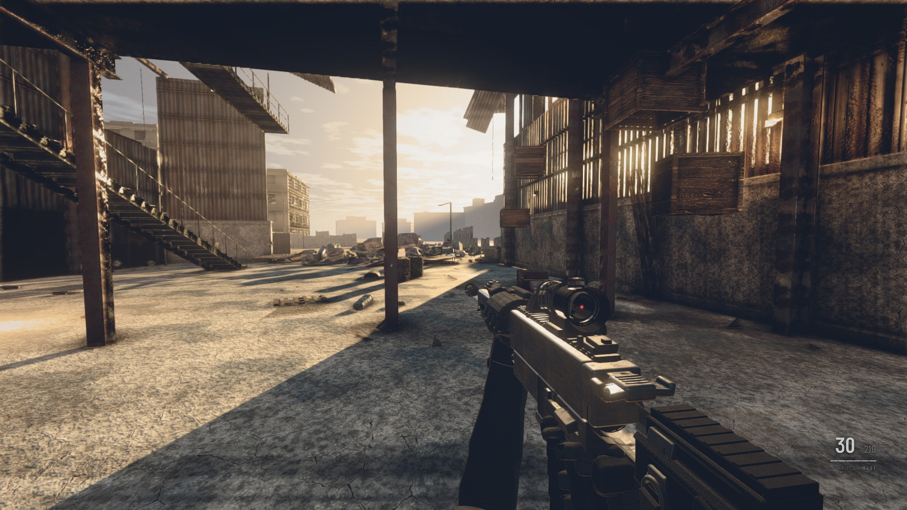
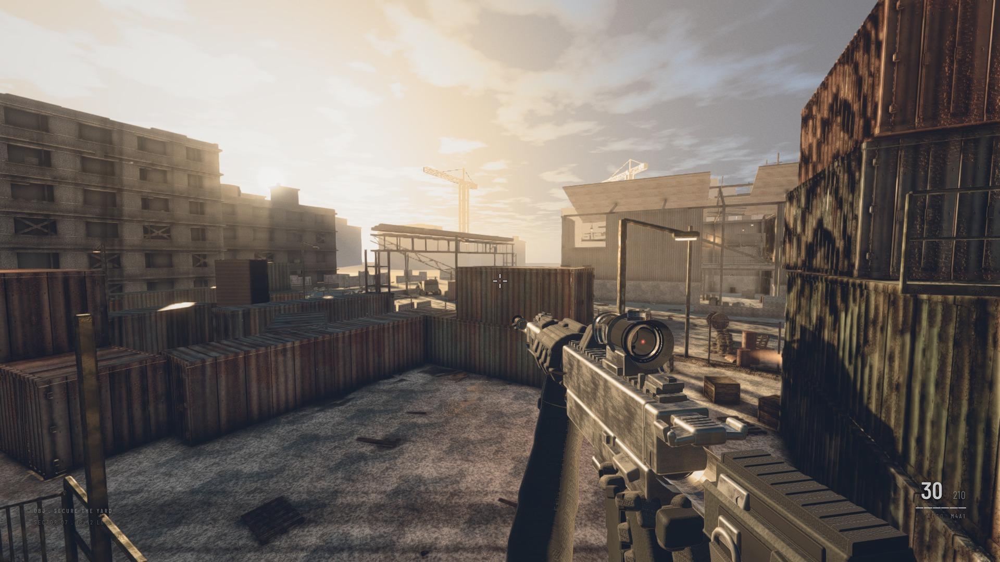
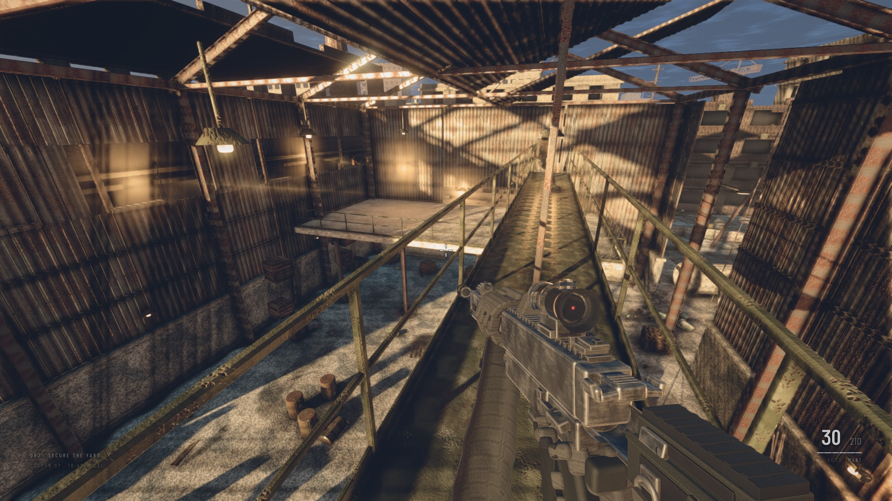
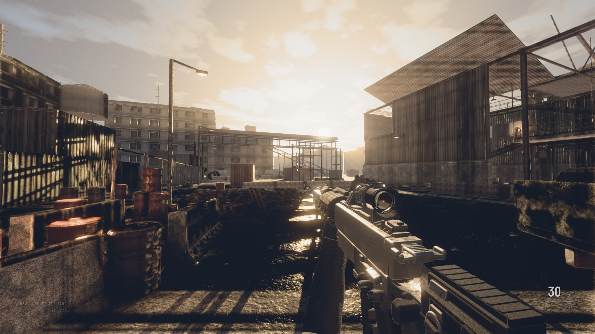
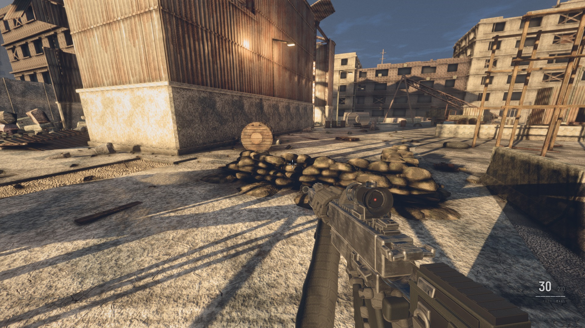

# Operation Blackout

A contemporary-military first-person shooter that runs in a browser tab.

**Every texture, every mesh, and every sound in this project is generated procedurally in
code.** There are no `.jpg`s, no `.glb`s, no `.hdr` environment maps, no `.wav` files, and no
CDN requests. The repository contains ~44,000 lines of JavaScript and nothing else. It boots
on a machine with no network connection.



---

## Table of contents

- [Quick start](#quick-start)
- [Screenshots](#screenshots)
- [What this actually is](#what-this-actually-is)
- [Controls](#controls)
- [Architecture](#architecture)
- [The eleven systems](#the-eleven-systems)
- [Rendering pipeline](#rendering-pipeline)
- [How it was built](#how-it-was-built)
- [Performance](#performance)
- [Audit](#audit)
- [Honest assessment](#honest-assessment)
- [Known issues](#known-issues)
- [Project layout](#project-layout)
- [Development](#development)

---

## Quick start

```bash
npm install
npm run dev          # http://localhost:5173
```

Click **Deploy** to lock the pointer and play. `Esc` releases the cursor.

Requires a WebGL2 browser. Developed and measured on an Apple M4 Pro (Metal 4) in Chrome.

```bash
npm run build        # production bundle -> dist/
npm run preview      # serve the built bundle
npm run shoot        # headless screenshot via Playwright
```

---

## Screenshots

All captured at 1920×1080 by the headless harness (`tools/shoot.mjs`), unedited, with the
in-game HUD visible.

### Yard — low sun, raking shadows


### Overwatch — stacked containers, layered depth


### Warehouse interior — volumetric shafts and sodium practicals


### Lane — into-sun framing, aerial perspective


### Close quarters — sandbags, contact shadows, ground detail


---

## What this actually is

A single-map arena FPS with bots, built to find out how close a browser can get to a
contemporary AAA military shooter's *look*.

The self-imposed constraint — **no external assets** — is the interesting part. It's not
minimalism for its own sake. It forces every visual to be earned by actual synthesis code:

- **Textures** are multi-octave FBM noise with domain warping, Sobel-filtered normal maps
  derived from *separately authored* height fields, decorrelated roughness fields, and
  multi-scale cavity terms driving crevice grime and edge wear.
- **Geometry** is procedural — the warehouse, the containers, the rifle, the soldiers are
  all built from code with beveled edges and per-instance variation.
- **Audio** is synthesised through the Web Audio API. A gunshot is a filtered noise
  transient, a pitch-swept low body, a mechanical layer, and a procedurally-generated
  impulse response run through a `ConvolverNode` for the environmental tail.

The trade is real: you cannot photogrammetry your way to detail. Everything has to come out
of a function.

---

## Controls

| Input | Action |
|---|---|
| `W` `A` `S` `D` | Move |
| `Shift` | Sprint |
| `Ctrl` | Crouch |
| `Space` | Jump |
| Left mouse | Fire |
| Right mouse | Aim down sights |
| `R` | Reload |
| `1` / `2` | Switch weapon (M4A1 / MP5) |
| `Tab` | Scoreboard |
| `Esc` | Release cursor |

---

## Architecture

The engine is a thin spine. Everything else is a **system** — a self-contained module that
plugs into a fixed lifecycle and never imports another system directly.

```js
export class MySystem {
  static id = 'mySystem';        // becomes ctx.mySystem
  static order = 50;             // update order band
  constructor(ctx) { this.ctx = ctx; }
  async init(onProgress) {}      // async setup, reports loading progress
  fixedUpdate(fdt) {}            // 60 Hz fixed step, physics-coupled
  update(dt, elapsed) {}         // per rendered frame
  resize(w, h) {}
  dispose() {}
}
```

Systems talk to each other two ways only: through a **shared `ctx` object** (populated by
`Engine.register()`), and through a **synchronous event bus** with a fixed set of canonical
event names. There are no cross-system imports, which is what allowed eleven of these to be
built in parallel by separate agents that could not see each other's code.

### Update order

Order is fixed and meaningful — a system may assume anything with a lower order is already
constructed and initialised when its `init()` runs.

| order | system | responsibility |
|---|---|---|
| 5 | `materials` | procedural PBR material library |
| 8 | `level` | map geometry, props, spawn points |
| 10 | `physics` | Rapier world, colliders, raycasts |
| 20 | `player` | movement, camera, stance, health |
| 30 | `ai` | bot rigs, animation, behaviour |
| 40 | `weapons` | viewmodel, ballistics, recoil |
| 50 | `fx` | impacts, decals, particles, tracers |
| 60 | `audio` | procedural synthesis, spatialisation |
| 70 | `lighting` | sky, IBL, cascaded shadows, practicals |
| 80 | `hud` | DOM overlay |
| 90 | `render` | owns the final composite |

### Frame structure

`Engine` clamps `dt` to 0.1s (so an alt-tab can't teleport anything through a wall), runs a
fixed-timestep accumulator at 60 Hz for `fixedUpdate` with a maximum of 5 substeps and
backlog shedding, then runs `update` once per rendered frame. `renderer.info` is reset once
per frame under manual control, because the post pipeline issues many internal render calls
and Three resets the counters on each one.

---

## The eleven systems

### `materials` — procedural PBR library
14 materials: concrete, asphalt, rustMetal, paintedMetal, corrugatedMetal, sandbags, wood,
plaster, brick, gravel, rubber, fabric, tarp, glass.

Each is generated as albedo (sRGB) + tangent-space normal + packed **ORM** (R=AO, G=roughness,
B=metalness) at 2048² for concrete and asphalt, 1024² for most, 512² for glass. Generation
runs across a **6-worker pool** with transferable `ArrayBuffer`s (~2.4s wall clock, ~310 MB
texture memory), with two-level graceful degradation to synchronous generation and then to a
plain material, so the game always boots.

Techniques include tileable Worley/cellular noise with per-cell IDs, ridged multifractal and
anisotropic FBM, F2−F1 crack networks masked by an independent field so cracks terminate and
branch rather than closing into polygons, gravity-following streak propagation, and
dual-metalness rust where metalness drops to 0 inside oxide but stays 1 on clean steel.

> **Important:** `get(name)` returns a 1:1 tiling variant. Use `getForSize(name, w, h)` or
> `getTiled(name, rx, ry)` for anything larger than ~2m, or a single tile stretches across
> the whole surface.

### `level` — the map
A ~90×70m bombed-out industrial yard in a three-lane layout: a warehouse with a collapsed
roof, interior catwalk and second floor; an outdoor yard with stacked containers, concrete
barriers, sandbag emplacements, drums, pallets, chain-link and rubble; and a perimeter of
taller structures so the player never sees the edge of the world.

Props are instanced with per-instance yaw, scale and colour variation. Every hard edge is
chamfered — bevels catching the key light is the single highest-leverage geometry decision
in the project.

### `physics` — Rapier
Fixed-timestep `world.step()` at 60 Hz. A collider→actor registry maps `collider.handle` to
game objects so raycasts can identify what they hit. Collision groups (`WORLD`, `PLAYER`,
`ENEMY`, `DEBRIS`, `PROJECTILE`) use Rapier's 32-bit group/filter encoding. Includes a
kinematic character controller with autostep and ground snapping, and a debris pool capped
at 190 globally with recycling.

> Rapier only rebuilds query structures inside `step()`, so a collider created between steps
> is invisible to `raycast()` until the next one.

### `player` — movement and camera
Source-style acceleration with separate ground/air values, friction applied only when
grounded. Smoothly interpolated stance transitions (never snapped). Figure-eight view bob
that fades to zero when stationary, landing dip proportional to fall velocity, strafe roll.

Recoil is an impulse into a spring-damper that only *partially* recovers — the player must
pull down, as in a real shooter — and is kept as a separate offset from aim so recovery
doesn't fight mouse input.

### `ai` — soldiers
Procedural humanoid rigs with plate carrier, helmet, pouches and knee pads. Walk/run cycles
with opposed limb motion, hip and shoulder counter-rotation, and foot IK. The upper body
aims independently of the lower body — torso twists toward the target while legs face the
movement direction, which is what makes them read as trained rather than as sliding props.

Behaviour is a state machine (IDLE, PATROL, INVESTIGATE, ENGAGE, FLANK, SEEK_COVER, RELOAD,
DEAD) over an A\* graph built by raycasting a grid at init. Perception uses vision cones with
reused raycast results, plus hearing via the `weapon:fire` event. Bots deliberately miss and
have a 200–400 ms reaction delay.

### `weapons` — viewmodel and ballistics
Two procedural weapons (M4A1, MP5) modelled at real scale with receiver, handguard rails,
magwell, buffer tube, charging handle, ejection port, iron sights and a red-dot optic with a
real glass element over a dark tube liner and baffle stack. Gloved hands with an indexed
trigger finger; the support hand leaves the handguard during reload to strip and seat the
magazine.

All animation is spring-damper driven. **Look sway** — the weapon lagging the camera and
settling — is the single most important feel detail. Hitscan ballistics use a spread state
that grows while firing and moving, with damage falloff, headshot multipliers and
penetration.

### `fx` — impacts and particles
Material-correct impacts: concrete throws grey dust and chips, metal throws orange sparks
with trails that bounce, wood splinters, dirt puffs. Bullet holes are projected decal
geometry that conforms to the surface, pooled and recycled with a hard cap.

> Transparent / `depthWrite:false` / `Points` / `Line` / `Sprite` objects are excluded from
> the G-buffer (they would poison normals and velocity), so particles receive no AO, no SSR
> and no TAA reprojection. The FX system is designed around that constraint.

### `audio` — procedural synthesis
No sample files. A gunshot is composed of a filtered noise transient with a sub-millisecond
attack, a pitch-swept low-frequency body, a metallic mechanical layer, and a convolved tail
using procedurally-generated impulse responses — a tight indoor warehouse slap and a wide
outdoor tail, crossfaded by whether the player is inside.

Full HRTF spatialisation with distance attenuation and a low-pass that increases with
distance (air absorption), so distant gunfire sounds dull rather than merely quiet. Per-shot
randomisation of pitch, cutoff and level prevents the machine-gun-loop effect.

### `lighting` — sky, IBL, shadows
A custom Preetham sky shader extended with a directional horizon haze band, a domain-warped
stratus deck, real lower-hemisphere ground radiance and a Mie sun disc. It is **mirrored
exactly on the CPU** so fog colour, hemisphere fill and key tint derive from the same
closed-form model rather than a GPU readback.

4-cascade CSM with texel snapping (without it, shadows crawl as the player walks),
per-cascade normal-offset bias derived from that cascade's world texel size, and constant
metre-width penumbra. Fog is height-stratified with a four-lobe directional inscatter
evaluation, so haze toward the sun is warm and bright while haze away from it is cool.

> Lighting globally replaces the fog `ShaderChunk`s at init, and sets
> `renderer.shadowMap.autoUpdate = false`, updating once per frame at order 70.

### `hud` — DOM overlay
Deliberately **not** a Three.js scene — the render system composites only the world and
viewmodel scenes, so a WebGL HUD would never appear. Dynamic crosshair that spreads with
weapon spread, hitmarkers, ammo counter, directional damage indicators, kill feed. No health
bar: damage is communicated by full-screen vignette, desaturation and directional impact
flashes.

### `render` — the final composite
See below.

---

## Rendering pipeline

A hand-built HDR pipeline. The stock `EffectComposer` passes are used only as plumbing; the
effects themselves are custom shaders.

1. **G-buffer / MRT** — colour, normal, depth, velocity into half-float targets.
2. **GTAO** — XeGTAO slice formulation, half res, depth+normal bilateral upsample, applied
   to the indirect term only.
3. **Screen-space contact shadows** — a short raymarch on the *direct* sun term. Ambient
   occlusion physically cannot darken under a crate lit by the sun; this is what grounds
   props.
4. **SSR** — binary-search refinement, roughness-aware jitter, edge fade, env-map fallback,
   with an early-out matched exactly to the composite's own blend weight.
5. **TAA** — Halton(2,3) projection jitter, velocity reprojection, YCoCg neighbourhood
   clipping, disocclusion rejection.
6. **Volumetrics** — raymarched sun shafts, half res, bilateral upsample.
7. **Motion blur** — per-pixel from the velocity buffer, clamped.
8. **Bloom** — soft-knee bright pass into a dual-filter mip chain. The tight lobe runs at
   quarter res; the taps are authored in UV so the skirt width is unchanged.
9. **Viewmodel composite** — the weapon renders into its own scene at a tighter 55° FOV
   (so it doesn't distort at the 78° world FOV) with a cleared depth buffer, and is
   composited **before** tonemapping so it receives the same film response as the world.
10. **Tonemap and grade** — AgX with selectable ACES, a highlight gamut ramp that walks
    chroma to neutral near clipping, cool shadow lift, warm highlight roll.
11. **Finish** — edge-only chromatic aberration, animated luminance-weighted grain, cos⁴
    vignette.

**Measured pass costs** (1080p, `overwatch` pose, 17.40 ms frame):

| stage | cost |
|---|---|
| HDR forward scene render | **~10–11 ms** |
| viewmodel MSAA surface | 1.00 ms |
| SSR + 2 bilateral | 0.90 ms |
| resolve (FXAA + CAS + grain) | 0.90 ms |
| GTAO + contact + 2 bilateral | 0.80 ms |
| bloom (both lobes) | 0.80 ms |
| G-buffer prepass | 0.70 ms |
| TAA | 0.50 ms |
| motion blur | 0.50 ms |
| volumetrics | 0.20 ms |
| **entire optional post stack** | **3.10 ms** |

The whole post stack is 3.1 ms of a 17.4 ms frame. The forward scene render dominates — a
useful correction to the intuition that post-processing is where browser renderers get slow.

---

## How it was built

This project was built by a fleet of parallel AI agents coordinated through a written
contract. That approach is worth documenting because it shaped the codebase.

### The contract

[`ARCHITECTURE.md`](ARCHITECTURE.md) is the build contract every agent read before writing a
line. It defines strict **directory ownership** (one agent per `src/<system>/`), the system
lifecycle, the update-order table, the exact cross-system API surface, and canonical event
names. Agents could not see each other's code, so the contract was the only thing preventing
them from destroying each other's work.

[`VISUAL_BAR.md`](VISUAL_BAR.md) is the grading rubric: nine axes scored 0–10, an
instant-fail list, and an explicit honesty clause stating that the critic's job is *"what is
the single largest remaining gap"* rather than *"is this better than Call of Duty"* — because
the latter question only ever has one answer and would never terminate.

### The phases

| phase | agents | output |
|---|---|---|
| **A — Foundation** | 4 + integration | materials, lighting, render, physics |
| **B — Content** | 2 art-fix + 7 content + integration | level, player, weapons, ai, fx, audio, hud |
| **C — Critic loop** | 3 rounds × (3 critics + ~6 fixers + verifier) | routed visual fixes |
| **D — Consolidation** | 4 + certifier | performance recovery, final QA |
| **E — Defects** | 2 | bot rendering, hit registration |

Roughly 40 agent invocations and ~16 million tokens.

### The critic loop, and why it was stopped

Three independent critics with different lenses (surfaces, light, composition) captured
their own screenshots, graded against the rubric, and produced located, actionable findings.
Findings were deduplicated, weighted by severity, and routed to the owning system, where up
to six fixers worked in parallel.

Scores across three rounds: **4.29 → 4.43 → 4.33**. It plateaued. Meanwhile geometry grew
from 4.7M to 6.5M triangles and framerate fell from 82 to 52 fps. The loop had become a
machine for trading performance for detail.

It was stopped and replaced with a consolidation pass that added no content: profile, cut,
LOD, instance culling, and restricting small casters to cascade 0. That reversed the
regression — **6.5M → 4.4M triangles, 52 → 72 fps** — and the final defect pass was worth
more than a fourth critique would have been.

### Findings worth recording

Several bugs were only found because agents were required to prove their claims rather than
assert them.

- **Double sRGB encoding on every weapon material.** `new THREE.Color(hex)` decodes to
  linear under `ColorManagement`, and that linear value was being packed into a byte handed
  to an sRGB-flagged texture. A tint authored at 0.157 reached the shader at 0.021 — seven
  times too dark. Someone had compensated by cranking the viewmodel key to 2.1× the world
  sun, which is why the gun looked lit by a different scene than the world.

- **Soldiers rendering as dithered noise.** Not transparency and not skinning — both were
  falsified by ablation (dumping live materials, swapping to `MeshNormalMaterial`). The real
  cause: normal maps baked from height fields carrying energy above texel Nyquist at gains
  of 17–34. At p90 the x channel quantised onto ~2 codes of 255, and mip-averaging normal
  *vectors* produced specular aliasing that is **static in surface space** — so every TAA
  frame agreed on the noise and it never resolved.

- **Double damage per round.** One bullet registered two `hit:actor` events at identical
  distance. Not "collecting all intersections" — the penetration loop was re-entering the
  same rigid body, which carries both a body capsule and a head ball sitting *inside* it.

- **A reload bug no screenshot could catch.** `_resetParts()` restored the magazine pivot to
  the origin rather than its rest pose, teleporting the magazine 56 mm up and 70 mm forward
  through the magwell after every reload. *"Invisible to the screenshot harness because it
  never reloads; plainly visible the first time you press R."*

- **A false alarm, retracted.** A QA agent first reported "damage does not register" after
  25 rounds produced zero actor hits, then found the bug was its own — it aimed with
  `atan2(dx,dz)` against the engine's `atan2(-dx,-dz)` convention and was firing 180° away
  from the target.

Three of the worst bugs were in the **harness**, not the game: a perf sampler counting
shader-compile warmup as gameplay frames (which caused three critics to file phantom
framerate failures), a Vite dev server reusing cached module transforms so a fixer spent an
hour tuning against code that was no longer running, and `PCFSoftShadowMap` silently
downgrading in r185.

---

## Performance

Measured by `tools/shoot.mjs`, which starts a private cold Vite server per capture, waits
for steady state, and excludes the ~3s shader-compile warmup from its statistics.

**Quiet machine** (Apple M4 Pro, 1920×1080):

| pose | fps | draw calls | triangles |
|---|---|---|---|
| spawn | 72 | 328 | 4.42M |
| lane | 65 | 367 | 4.64M |
| warehouse | 64 | 304 | 4.45M |
| closeup | 63 | 350 | 4.57M |
| overwatch | 59 | 363 | 4.55M |

**Busy machine** (load average ~17, the same box under other work): 53–65 fps.

Framerate is sensitive to GPU contention. Concurrent headless captures can swing the same
code between 4 and 76 fps, so any number taken while other work is running should be
discarded.

Bundle: 3.74 MB raw, **1.29 MB gzipped** — almost entirely Three.js and Rapier.
Texture memory: ~310 MB. Warmup: ~3.0s of shader compilation on first load.

---

## Audit

Run on the full tree prior to publication.

| check | result |
|---|---|
| Hardcoded secrets / API keys / tokens | **none** |
| External network calls (`fetch`, `XMLHttpRequest`, CDN) | **none** |
| External asset references (`.jpg`, `.glb`, `.hdr`, `.wav`) | **none** |
| `TODO` / `FIXME` / `XXX` / `HACK` | **0** |
| `debugger` statements | **0** |
| `console.log` (non-warn/error) | 1 |
| Production build | **passes** (239 ms) |
| Boot errors across all 5 poses | **0** |
| Runtime dependencies | 2 (`three`, `@dimforge/rapier3d-compat`) |
| Dev dependencies | 2 (`vite`, `playwright`) |

The only console output at runtime is two Three.js deprecation warnings (`THREE.Clock`, and
a Rapier init-params notice).

**Code distribution** (~44,000 lines):

| system | lines | files |
|---|---|---|
| level | 8,083 | 5 |
| weapons | 6,141 | 9 |
| fx | 4,498 | 7 |
| ai | 4,389 | 8 |
| materials | 4,121 | 5 |
| render | 4,044 | 5 |
| lighting | 3,841 | 9 |
| audio | 2,355 | 5 |
| player | 2,351 | 5 |
| ui | 1,993 | 9 |
| physics | 1,537 | 4 |
| core | 446 | 4 |

---

## Honest assessment

The project was graded **6.2/10 (56/90)** by an independent certification pass, up from an
average of 4.3 across the three critic rounds.

**It fails its own rubric.** `VISUAL_BAR.md` requires every axis ≥7 and a total ≥68.

| axis | score |
|---|---|
| lighting | 7 |
| atmosphere | 7 |
| composition | 7 |
| grade | 7 |
| materials | 6 |
| contact | 6 |
| post | 6 |
| geometry | **5** |
| viewmodel | **5** |

This is not Call of Duty and was never going to be. Modern CoD is roughly 1,500 people over
3–4 years with a custom engine, photogrammetry pipelines and motion-capture stages, streaming
hundreds of gigabytes off an NVMe. The remaining gap here is almost entirely **asset density
and hand-authored detail** — the things that budget buys and procedural synthesis cannot
fully substitute for.

What it does demonstrate is that a browser can hold a full HDR deferred-ish pipeline with
GTAO, SSR, TAA, volumetrics and cascaded shadows over a real physics simulation with bots, at
60 fps, with a zero-byte asset budget.

---

## Known issues

**Visual**
- Distant buildings are boxes with punched window openings — no reveals or sills.
- The rifle buttstock is under-detailed relative to the rest of the weapon, and occupies the
  bottom-right of every frame.
- Mid-distance shadows are soft/blobby; 2048px across 4 cascades runs out of resolution
  (visible on warehouse roof-slat shadows).
- Motion blur is slightly over-applied at frame edges.
- Bots at 20–30 m were not visually verified as rigorously as at 8 m.

**Gameplay**
- Bot focus-fire is punishing — standing in the open is lethal in ~2s. This is a balance
  problem, not a bug.

**Tooling**
- Headless Chromium refuses pointer lock, and input is gated on `input.locked`, so
  `tools/shoot.mjs` cannot exercise gameplay. Gameplay QA requires driving the page directly
  with Playwright and calling engine APIs.
- Viewmodel-vs-wall clipping is untested; `VISUAL_BAR.md` lists it as an instant-fail item,
  so it remains an unverified risk.

**Performance**
- `overwatch` sits at 59 fps on a quiet machine, 1 fps under the 60 target.
- Bundle is a single 3.74 MB chunk with no code splitting.

---

## Project layout

```
.
├── ARCHITECTURE.md          # the build contract — system API, ownership, integration notes
├── VISUAL_BAR.md            # the grading rubric used by the critic agents
├── CHANGELOG.md
├── index.html               # boot veil, deploy prompt, canvas host
├── vite.config.js
├── docs/screenshots/        # captured by tools/shoot.mjs
├── tools/
│   └── shoot.mjs            # headless capture harness (private cold server per run)
└── src/
    ├── main.js              # system registration, perf sampling, pose API
    ├── core/                # Engine, Config, EventBus, Input  (fixed — not agent-owned)
    ├── materials/           # procedural PBR library + worker pool
    ├── level/               # map geometry, kit, props, spawns
    ├── physics/             # Rapier world, groups, debris, debug view
    ├── player/              # controller, camera rig, poses
    ├── ai/                  # soldier rig, navigation, behaviour, textures
    ├── weapons/             # models, procgen, ballistics, animation
    ├── fx/                  # impacts, decals, particles, tracers
    ├── audio/               # synthesis, impulse responses, spatialisation
    ├── lighting/            # sky, CSM, atmosphere, practicals
    ├── ui/                  # DOM HUD
    └── render/              # G-buffer, post stack, shaders
```

---

## Development

**Adding a system.** Create `src/<name>/index.js` exporting a class with `static id` and
`static order`, then register it in `src/main.js`. Read `ARCHITECTURE.md` first — in
particular the *Integration Notes* section, which documents the landmines discovered during
the build.

**The three that will bite you:**

1. **Register every lit material with CSM.** A lit material that skips
   `ctx.lighting.registerMaterial(mat)` takes the non-CSM shader branch and receives all four
   cascade lights at full intensity — 4× overexposed.
2. **Use `getForSize` / `getTiled`,** never bare `get()`, for surfaces larger than ~2m.
3. **The HUD must be DOM.** The render system composites only `ctx.scene` and
   `ctx.viewmodelScene`.

**Screenshots.**

```bash
node tools/shoot.mjs --out shot.png --pose warehouse --wait 32000
npm run shoot:all      # regenerate the full docs/screenshots set
```

Poses: `spawn`, `overwatch`, `warehouse`, `lane`, `closeup`. The harness exits non-zero and
prints page errors if anything threw — a screenshot alone is not proof the build works. Do
not pass `--port`; it picks a private one per invocation.

**Debug toggles** live in `src/core/Config.js` (`debug.wireframe` for physics colliders,
`debug.freeCam`, `debug.showStats`), and every post effect is individually switchable under
`render.*` for A/B comparison.

---

## Licence

UNLICENSED — private project.
